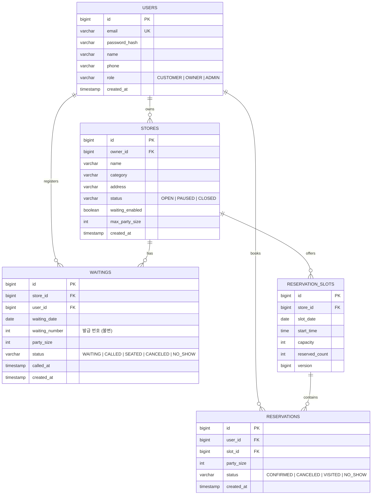

# 설계 문서

## 1. ERD

- 발급 번호(`waiting_number`)와 현재 순번은 분리합니다. 현재 순번은 저장하지 않고 Redis `ZRANK`로 계산합니다.
- 제약 조건
  - `UNIQUE (store_id, waiting_date, waiting_number)`
  - `UNIQUE (store_id, user_id) WHERE status IN ('WAITING','CALLED')` (PostgreSQL 부분 인덱스)

## 2. 동시성 제어

| 문제 | 해결 | 최종 방어선 |
|---|---|---|
| 번호 중복 발급 | Redis `INCR waiting:seq:{storeId}:{yyyyMMdd}` | DB 유니크 제약 |
| 같은 사용자 중복 요청 | 멱등키 + Redis `SET NX EX` | 부분 유니크 인덱스 |
| 예약 초과 | 조건부 UPDATE (기본안) / 비관적 락 | `reserved_count <= capacity` 검증 |

- 대기열 순서: Redis ZSET `waiting:queue:{storeId}` (score = 발급 번호)
- DB가 원본이고 Redis는 재구축 가능한 보조 저장소입니다. Redis 반영은 `@TransactionalEventListener(AFTER_COMMIT)`에서 합니다.
- 조건부 UPDATE, 비관적 락, 낙관적 락을 동시 요청 테스트(ExecutorService + CountDownLatch)와 k6로 비교한 결과를 이 문서에 기록합니다.

## 3. 실시간 반영 (SSE)

- `GET /api/waitings/{id}/stream` (고객), `GET /api/stores/{storeId}/waitings/stream` (점주)
- 상태가 바뀌면 커밋 후 `PUBLISH store:{storeId}:events`를 보냅니다. 각 인스턴스는 로컬 SseEmitter로 최신 순번을 전송합니다.
- 연결 직후 현재 상태 스냅샷을 보내고, 30초마다 하트비트를 보냅니다. 인증은 HttpOnly 쿠키로 합니다.
